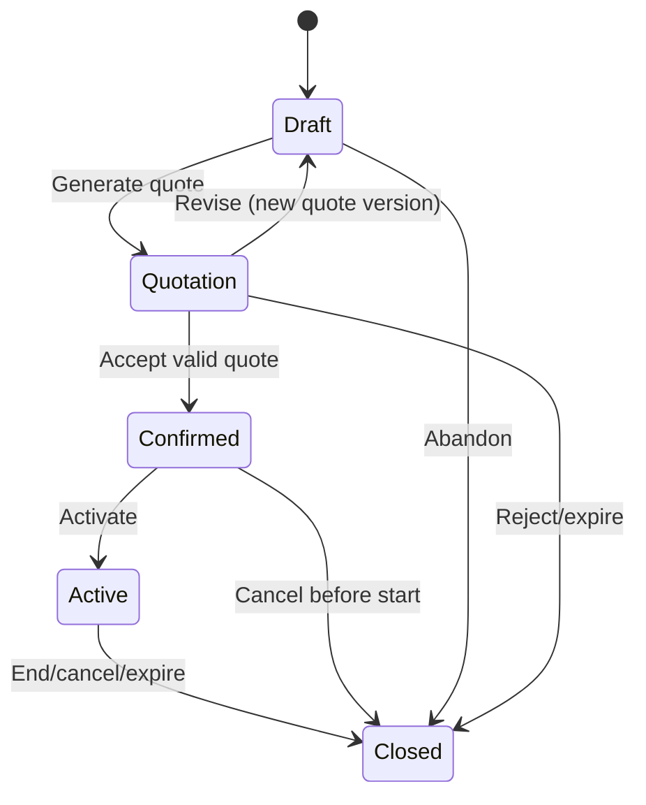

# Subscription Management System — Master Product Requirements Document (PRD)

**Document ID:** SMS-PRD-001  
**Version:** 2.0  
**Date:** 31 October 2026  
**Status:** Approved build baseline for prototype/MVP; jurisdiction-specific production compliance requires sign-off  
**Audience:** Senior engineer, engineering team, designer, QA, DevOps, product owner  
**Product:** Multi-tenant B2B Subscription Management System (web application)  
**Source:** The six stated feature pillars and the accompanying detailed developer specification.

> **Handoff contract:** Implement the decisions and defaults in this document without waiting for routine product clarification. When a legal, payment-provider, or deployment-specific choice cannot safely be assumed, implement the configurable behavior and documented safe default, then require an administrator to configure it before live financial processing. This is a complete implementation baseline, not a representation that unspecified business decisions were provided by the original brief.

## A. Product vision, problem, outcomes, and scope

### A.1 Product vision
Provide a single system for sales, billing, finance, and management to convert a proposed subscription into a tracked, invoiced, paid, analyzed, and ultimately closed customer relationship. Every monetary change must be traceable; every scheduled invoice must be reproducible; every user action must respect roles and tenant boundaries.

### A.2 Problem statement
Without a unified system, businesses rely on spreadsheets and disconnected quotation, invoice, and payment records. They cannot reliably answer what was sold, what is active, which invoice belongs to which billing cycle, what discount was valid, how much has been paid, or what is overdue. Manual workflows cause duplicate invoices, missed billing, pricing inconsistency, and unreliable revenue reports. Slow lists become unusable as records grow.

### A.3 Measurable success criteria
| ID | Outcome | Target and measurement |
|---|---|---|
| KPI-01 | Reliable invoice generation | 100% of eligible due billing periods eventually have exactly one issued invoice or a recorded actionable failure; daily reconciliation |
| KPI-02 | Financial correctness | Zero unexplained discrepancies between invoice totals, credits, allocations, and outstanding balances in automated reconciliation |
| KPI-03 | Fast user experience | p95 server response for standard list/detail APIs <2 seconds at seeded load of 10,000 subscriptions per tenant, excluding third-party calls and PDF rendering |
| KPI-04 | Operational visibility | Dashboard totals reconcile with ledger/source tables for identical tenant, currency, date range and as-of timestamp |
| KPI-05 | Traceability | 100% of lifecycle transitions, financial issuance, payment reversals and permission changes have actor, timestamp, tenant, and event details |
| KPI-06 | Access safety | No cross-tenant reads or writes in automated security tests |

### A.4 Scope for first production-capable release
**Included:** tenant and user management; customers; plans and versioned prices; Draft → Quotation → Confirmed → Active → Closed; quotation acceptance; recurring fixed-price subscriptions; invoice issue and PDF; configurable taxes; fixed and percentage discounts; manual/offline payments; partial/multiple allocations; credits/reversals; overdue status; dashboard and exports; notification jobs; audit logs; responsive web UI; admin settings; backups, health checks, monitoring and load tests.

**Excluded from mandatory v1:** card storage, direct debit collection, online payment gateway, complex metered usage billing, automatic accounting journal posting, multi-currency conversion, mobile native apps, AI churn forecasting, marketplace integrations. Design extension points but do not delay core delivery for these.

### A.5 Personas and core jobs
- **Tenant Owner:** configures company, billing settings, members, taxes, numbering, and access.
- **Sales Manager:** creates customers, plans, draft subscriptions, quotations, and records customer acceptance.
- **Billing Manager:** activates subscriptions, issues and corrects invoices, manages discounts, resolves billing errors.
- **Finance User:** records and reconciles payments, credits, refunds, and overdue receivables.
- **Read-only Analyst:** views and exports permitted dashboard metrics without modifying financial data.
- **Platform Operator:** provisions and supports tenants, monitors infrastructure, without implicit access to tenant business records.

### A.6 Guiding principles
Server-enforced state machine; append-only financial history; integer minor-unit amounts (or fixed decimal where necessary); tenant-scoped data; UTC storage and explicit tenant timezone; idempotent workers; no hidden recalculation of issued documents; predictable empty/error/loading states; accessible keyboard-friendly UI.

## B. Default product decisions — no developer guessing

| Topic | Required v1 decision |
|---|---|
| Default timezone | `Asia/Kolkata` per tenant, editable; store instants UTC and billing calendar dates in tenant timezone |
| Default currency | INR; tenant can configure supported ISO-4217 currencies, but one currency per subscription/invoice and no FX conversion |
| Default billing | In advance, on activation and each anniversary; monthly or yearly frequency; due date 14 calendar days after issue |
| Monthly anniversary | Clamp to last valid day of shorter month; preserve original anchor day for later months |
| Free trials | Not required; may be modeled by a future start date without an invoice before activation |
| Quotation validity | 30 calendar days from issue; expired quotations cannot be accepted without reissue |
| Subscription activation | Confirmed → Active only by authorized billing action when start date reached; background scheduler may activate on date if tenant setting enabled (default disabled) |
| Subscription end | Closed is terminal; no automatic billing after close; reactivation requires a new subscription linked to original |
| Cancellation | Immediate or scheduled end-of-current-period; scheduled closure remains Active until effective date |
| Proration | Disabled in v1 for mid-cycle changes; schedule price/quantity changes for next period; manual credit note for approved corrections |
| Tax | Inclusive/exclusive configurable per tax rule; default no tax until tenant tax configuration completed; never hardcode GST rate |
| Discount stacking | One active subscription-level discount and one optional invoice-level discount; v1 default forbids stacking both on same line; deterministic priority by explicitly selected campaign |
| Rounding | Decimal arithmetic, round half-up to currency minor unit at line-tax level, then sum; preserve exact calculation snapshot |
| Payment | Manual entry only; partial payments and allocations across invoices supported; no auto-mark-paid from a note alone |
| Overpayments | Unapplied customer credit balance; never create a negative invoice balance |
| Refunds | Manual refund record and corresponding reversal/credit adjustment; no automatic bank transfer |
| Invoice numbering | Unique tenant + fiscal year + sequence, e.g. `INV-2026-27-000001`; reserve number atomically at issue, never reuse |
| Late fees | Disabled in v1; overdue detection does not automatically change invoice amount |
| Notifications | Email on quote issue, invoice issue, payment receipt, upcoming due date and overdue; deduplicate events; tenant can toggle each |
| Data deletion | Soft-delete nonfinancial master data where allowed; issued financial records never hard-delete via application |
| Language | English interface in v1; text externalized for later localization |
| Date reporting | Filter by tenant-local calendar dates, report timestamp and currency explicitly |
| Decimal precision | Unit price up to 4 decimal places in calculation, posted amounts 2 for INR; use currency exponent for others |


## C. Complete screen-level UI contract

All pages require loading skeleton, empty state with a meaningful action, validation errors adjacent to fields, success/error toast, permission-based actions, pagination and consistent breadcrumbs. Use a left sidebar on desktop and accessible navigation on mobile. Never rely on frontend hiding as authorization.

| Route | Required content | Primary actions | Filters / details |
|---|---|---|---|
| `/login` | email, password, forgot password | sign in | field errors, rate-limit messaging |
| `/app` | KPI cards, charts, recent activity, alerts | navigate to invoices/overdues | date, currency, plan, customer, status |
| `/app/customers` | customer list, contact, outstanding balance | add, edit, archive | search, status, created date |
| `/app/customers/:id` | identity, billing address, subscriptions, invoices, payments | edit, create subscription | tabs, activity timeline |
| `/app/plans` | plans, prices, billing interval, status | create, version, archive | search, interval, active |
| `/app/subscriptions` | subscription ID, customer, plan, state, amount, next billing | create, export | status, date, plan, customer |
| `/app/subscriptions/new` | guided creation form | save draft | customer, plan version, quantity, dates, currency, discount |
| `/app/subscriptions/:id` | summary, line items, state timeline, quote, invoices, payments, audit | issue quote, confirm, activate, close | contextual allowed actions only |
| `/app/quotes` | quote number, customer, amount, expiry, acceptance | view, send, reissue | status, date, customer |
| `/app/quotes/:id` | immutable quote snapshot, PDF, history | download, record acceptance | expiry and decision details |
| `/app/invoices` | invoice number, customer, totals, paid, balance, due date | view, export, record payment | overdue, date, status, customer |
| `/app/invoices/:id` | tax breakdown, lines, allocations, adjustments, audit | PDF, record payment, issue credit | immutable issue snapshot |
| `/app/discounts` | code, type, value, eligibility, validity, usage | create, disable, edit future rules | date, active, code |
| `/app/payments` | reference, method, customer, amount, allocations | record, reverse, export | date, method, customer, status |
| `/app/payments/new` | customer, method, date, amount, note, invoice allocation rows | save payment | real-time remaining/unallocated total |
| `/app/analytics` | KPIs, trends, aging, tables | change filters, export CSV | as-of date, interval, currency |
| `/app/settings` | organization, taxes, numbering, billing, notifications | save configuration | tenant owner only |
| `/app/team` | users, roles, invitations | invite, change role, revoke | role, status |
| `/app/audit` | read-only event history | search, export | actor, object, action, time |
| `/app/jobs` | billing queue, failed runs, retries | retry safe failures | admin/billing permissions |

### C.1 Form validation
Customer name required (1–200 characters); email must be syntactically valid if provided; billing country and address required before issuing an invoice; plan code unique per tenant; plan unit price nonnegative; quantity positive integer by default; subscription start date required before confirmation; discounts must have value >0 and percentage <=100; usage limits nonnegative integers; payment amount >0; allocation sum <= payment amount and each allocation <= outstanding invoice balance. Validate on client for usability and server for authority. Return stable error codes, not only human-readable strings.

### C.2 Design behavior
Use explicit confirmation dialogs for issuing, closing, reversing and crediting; display invoice numbers as copyable text; show currency and tax basis beside all monetary totals; visually distinguish unpaid/partially paid/paid/overdue/void; provide print-friendly PDF and CSV exports; never display a button for a transition the current state disallows.

## D. Detailed business rules and lifecycle acceptance

| From | Trigger | Preconditions | Result and side effects |
|---|---|---|---|
| Draft → Quotation | Issue quotation | customer, plan snapshot, price, quantity, term, currency valid | generate immutable numbered quote and PDF; set quote expiry; audit; queue notification |
| Quotation → Draft | Revise quotation | quote not accepted; authorized sales user | preserve old quote as superseded; create editable new draft version |
| Quotation → Confirmed | Record acceptance | current quote unexpired; authorized user; acceptance evidence stored | freeze accepted terms, timestamp, actor, acceptance source; schedule activation |
| Confirmed → Active | Activate | start date reached, configuration complete, not already active/closed | establish billing anchor; enqueue first billing period exactly once |
| Active → Closed | Close | authorized action, reason, effective date | stop future periods from effective close; retain historical invoices and payment ability |
| Draft/Quotation/Confirmed → Closed | Abandon/cancel | reason required | close without future billing; preserve documents |

All other transitions return `409 INVALID_STATE_TRANSITION`. A closed subscription is not reopened. An active subscription cannot be returned to Draft. Quotation acceptance is a **recorded business event**, not a cryptographic e-signature in v1. For quotes that expire during an acceptance attempt, server time wins. All transition endpoints require an idempotency key and optimistic concurrency version.

**Important edge cases:** repeated double-click; two staff issuing same quote; billing job running during closure; customer changed after quote issue; plan price changed after confirmation; backdated start; end-of-month billing; leap day; timezone midnight; failed PDF generation after DB commit; expired discount between quote and activation. Apply immutable snapshots and transactional checks rather than trusting stale UI values.

## E. Financial calculation contract and worked example

**Evaluation order for each invoice line:** versioned unit price × quantity → eligible discount → taxable base → applicable taxes → line total. Persist price, discount, tax rule identifiers and versions, rounding policy, calculation breakdown, and result in the invoice snapshot. Invoice totals equal the sum of posted line totals; never recalculate a historical issued invoice using current tax or discount settings.

**Illustrative example (exclusive tax):** 2 seats × ₹1,000 = ₹2,000 subtotal. A valid 10% discount is ₹200. Taxable amount ₹1,800. Example configured tax rate 18% gives ₹324 tax. Invoice total = **₹2,124**. If ₹1,000 is paid, outstanding balance = **₹1,124**. The 18% figure is only an example of a tenant-configured rate, not a default or legal determination.

**Tax-inclusive example:** gross taxable price ₹1,180 at a configured 18% inclusive tax implies pre-tax base ₹1,000 and tax ₹180, before any discounts. For discounts on inclusive prices, apply the discount to the tax-inclusive amount and recompute embedded tax from the discounted gross using the applicable rule. Store the exact method in the snapshot.

**Invoice status algorithm:** `draft` (not yet issued), `issued/unpaid` (balance >0 and no payments), `partially_paid` (0 < allocated net payments < payable total), `paid` (balance =0), `overdue` (balance >0 and tenant-local current date > due date), `void` (only where policy permits and never for already paid invoice). Overdue is an orthogonal flag derived from date and balance, not a replacement for payment status. Credit notes reduce payable amount and preserve auditability.

**Discount redemption:** validate tenant, status, eligible plan/customer, minimum subtotal, active date interval, per-customer limit, global limit, and any coupon code; reserve/consume usage transactionally when the eligible invoice is issued, not during quote preview; release only under an explicitly defined void/reversal rule. For recurring campaigns, `once` applies to first eligible billing period, `repeat_n` to next N eligible periods, `forever` while eligible.

**Payment allocation:** a payment belongs to one customer and currency; allocations may span that customer's invoices in that currency only. The sum of allocations cannot exceed net payment value; each invoice allocation cannot exceed balance after credits. Concurrent payment submissions lock invoice balances transactionally. Reversal is a new audit-tracked transaction and recalculates affected balances; never overwrite the original receipt.

## F. Background processing and timing

| Job | Trigger | Idempotency / retry behavior |
|---|---|---|
| Activate scheduled subscriptions | every 15 minutes, if auto-activation enabled | unique activation event per subscription and scheduled start |
| Generate due billing periods | hourly plus daily catch-up | unique `(tenant_id, subscription_id, period_start, period_end, invoice_kind)` constraint |
| Generate invoice PDF | invoice-issued event | store versioned immutable artifact; retry with exponential backoff |
| Send notifications | outbox event | unique `(event_id, template_id, recipient)` delivery record |
| Refresh analytics aggregates | event-driven plus nightly reconciliation | safe rebuild from authoritative records |
| Mark overdue and send reminders | daily at tenant-local morning | dedupe per invoice, reminder stage and date |
| Reconcile billing/payment integrity | nightly | emit exceptions and alerts; no silent auto-fixes |

On worker failure, persist error reason, attempt count, next retry time, and operator-visible status. After retry exhaustion, send alert and allow safe manual retry. A job must not create duplicate invoices or send repeated receipts after a crash.

## G. Developer API conventions and payload examples

Use `/api/v1`; JSON request/response; bearer auth or secure HTTP-only session; pagination via cursor or page/limit with documented stable ordering; UTC ISO-8601 timestamps; ISO-4217 currency codes; integer minor-unit monetary values in public API unless clearly documented fixed-decimal unit price; `Idempotency-Key` on financial and transition POSTs; `If-Match`/version for conflicting updates. Use consistent errors:

```json
{"error":{"code":"INVALID_STATE_TRANSITION","message":"Only confirmed subscriptions can be activated.","details":{"currentState":"draft"},"requestId":"req_123"}}
```

**Representative create subscription request:**

```json
{
  "customerId":"cus_123",
  "planVersionId":"plv_456",
  "quantity":2,
  "startDate":"2026-11-01",
  "billingInterval":"monthly",
  "currency":"INR",
  "discountCode":"WELCOME10"
}
```

**Representative invoice response:**

```json
{
  "id":"inv_123",
  "invoiceNumber":"INV-2026-27-000001",
  "subscriptionId":"sub_123",
  "currency":"INR",
  "subtotalMinor":200000,
  "discountMinor":20000,
  "taxMinor":32400,
  "totalMinor":212400,
  "paidMinor":100000,
  "balanceMinor":112400,
  "issuedAt":"2026-11-01T04:30:00Z",
  "dueDate":"2026-11-15",
  "paymentStatus":"partially_paid",
  "overdue":false
}
```

Every mutating endpoint must specify required role, request schema, response schema, validation, idempotency and audit behavior in OpenAPI. See the reference specification below for the full endpoint inventory and data model.

## H. Analytics metric dictionary

| Metric | Exact definition |
|---|---|
| Active subscriptions | Count subscriptions in Active state as of requested timestamp, tenant-scoped |
| MRR | Sum of recurring contracted net monthly amounts for active subscriptions; annual contracts /12; excludes one-time taxes and nonrecurring fees; discount duration reflected when currently effective |
| ARR | MRR ×12, a run-rate metric, not recognized revenue |
| Invoiced revenue | Sum of issued invoice net-of-discount amounts excluding tax, minus issued credit note net amounts within selected period |
| Collected payments | Net successfully recorded payments in selected date range, minus reversals/refunds; distinguish received cash from allocations |
| Outstanding receivables | Sum positive invoice balances after valid credits and payment allocations at report as-of time |
| Overdue invoices | Count issued invoices with balance >0 and due date before tenant-local as-of date |
| Overdue amount | Sum remaining balances of overdue invoices |
| Aging buckets | Outstanding balances grouped by days past due: current, 1–30, 31–60, 61–90, 90+ |
| Conversion rate | Quotes accepted / quotes issued within chosen cohort; show denominator and cohort window |

Never sum different currencies into a single money figure without conversion; show currency selector or per-currency rows. Label invoice revenue separately from collected payments and contracted recurring revenue. Every dashboard card must link to a filtered drill-down list.

## I. Security, privacy, resilience and operations acceptance

- Enforce tenant membership at query, service, background worker and file-download boundaries; verify object tenant ownership even for guessed IDs.
- Require strong password hashing, secure session cookies or properly validated tokens, MFA support for privileged roles, rate limits, and audit of login/permission events.
- Encrypt traffic via HTTPS and sensitive storage at rest; never log passwords, secrets, full payment account details or access tokens.
- Use parameterized queries, schema validation, CSRF protection when cookie-authenticated, and safe file generation.
- Maintain daily automated backups with tested restore procedure; target RPO <=24 hours and RTO <=8 hours for v1 unless deployment contract supersedes.
- Log request ID, tenant ID, actor ID, entity ID, job ID, result and latency; redact personal information from diagnostics.
- Require automated tests for authorization, invoice math, discount concurrency, invoice job retry, race conditions, CSV injection, and tenant isolation.
- Make tax invoice fields, document retention, consent, data residency and privacy notices configurable/subject to legal review before production.

## J. QA scenarios and sign-off demonstrations

| ID | Scenario | Expected result |
|---|---|---|
| E2E-01 | Create customer and plan, then create draft | draft stored with immutable selected plan version reference |
| E2E-02 | Issue quotation twice using same key | one quote issued, same result returned |
| E2E-03 | Accept expired quote | rejected; reissue required |
| E2E-04 | Activate confirmed subscription | active state, billing anchor set, first invoice created exactly once |
| E2E-05 | Run billing worker twice | one invoice per billing period |
| E2E-06 | Apply expired/ineligible coupon | server rejects or omits discount with explicit reason |
| E2E-07 | Concurrent final coupon redemption | usage cap never exceeded |
| E2E-08 | Record partial payment | correct partial status and outstanding balance |
| E2E-09 | Allocate payment across invoices | allocations reconcile and never exceed payment amount |
| E2E-10 | Reverse payment | original preserved, balances and analytics corrected |
| E2E-11 | Close subscription before next cycle | no post-close billing; existing invoices remain collectible |
| E2E-12 | Change plan price after invoice issue | issued invoice unchanged; future price change only per agreed effective date |
| E2E-13 | User from tenant A requests tenant B invoice | no data disclosure; 403/404 consistent with security policy |
| E2E-14 | Seed 10k subscriptions and exercise common screens | p95 API latency <2s under documented test workload |
| E2E-15 | Worker crashes after commit | safe retry, no duplicate invoice or email |
| E2E-16 | Analytics drilldown by date and currency | chart and table totals reconcile to source records |
| E2E-17 | Browser refresh during form creation | no unintended duplicate submission |
| E2E-18 | Keyboard-only navigation and small screen | core flows remain usable and accessible |

## K. Release checklist and engineering deliverables

**Deliverable repository:** monorepo with frontend, backend, worker, DB migrations, seed scripts, typed shared contracts, unit/integration/E2E tests, OpenAPI spec, Docker compose, CI, `.env.example`, README and architecture decisions. Never commit secrets.

**Minimum deployment:** production frontend, API, worker, PostgreSQL, Redis, object storage for PDFs, transactional email integration, TLS, backups, monitoring, migration runner, and admin account bootstrap. If email provider is unavailable for demo, queue and display email previews in a development-only mailbox.

**Release gates:** all critical E2E scenarios pass; no open critical/high security bugs; seed and migrations repeat cleanly; invoice/PDF snapshots reconcile; billing retry tests pass; tenant-isolation tests pass; load report attached; backup restoration demonstrated; feature flags and environment variables documented; demo script reproducible.

**Implementation order:** foundation and RBAC → customer/plan catalog → lifecycle and quote PDF → invoice/tax/discount engine → payment ledger → reporting → automation and notifications → security/performance hardening → deployment and handover.

---

# Annex 1 — Detailed Engineering Reference Specification

The following reference is incorporated as part of this PRD. In any conflict, the explicit defaults and definitions in Sections A–K above govern v1; the annex provides additional implementation depth and endpoint/schema inventory.

# Subscription Management System — Complete Developer Specification

**Version:** 1.0 | **Status:** Implementation-ready reference specification | **Product type:** Multi-tenant B2B SaaS subscription operations platform

> This specification expands the supplied requirements into an explicit, buildable product design. Choices not specified by the original brief (stack, roles, invoice numbering, proration, tax policy, etc.) are **proposed product decisions**, not claims about the original problem statement. The implementation must make regulatory and tax configuration jurisdiction-specific before production use.

## 1. Executive summary

Build a web application in which businesses manage customers, subscription plans, quotations, contracts/subscriptions, recurring invoices, discounts, payment records, and financial dashboards. A subscription progresses **Draft → Quotation → Confirmed → Active → Closed**. Each state has controlled actions, audit history, permissions, and side effects. The platform supports thousands of subscriptions per tenant while keeping ordinary list and detail page API response times under two seconds at the specified test load.

### Product contribution
- **Lifecycle:** prevents informal, inconsistent subscription activation and makes status traceable.
- **Billing:** eliminates manual recurring invoice calculation and reduces missed billing cycles.
- **Discounts:** supports promotions while controlling eligibility and revenue leakage.
- **Payments:** gives finance a reliable record of what was paid against which invoice.
- **Analytics:** converts operational data into actionable revenue and collections insights.
- **Performance:** keeps the system usable as customer and transaction volumes grow.

### Explicit scope assumptions
- Business-to-business platform; each organization is a **tenant** with isolated data.
- A tenant can have multiple internal users and many customer accounts.
- Currency is fixed per subscription and invoice; cross-currency settlement is out of MVP scope.
- Payments may be recorded manually; an online payment gateway is an optional integration.
- Tax rules are configurable, not hardcoded to a single country's laws.
- A confirmed subscription does **not** become active until activation conditions are met.
- Closed subscriptions are immutable for billing; corrections use credit notes and audit events.

## 2. Actors, access, and permissions

| Role | Responsibilities | Access |
|---|---|---|
| Platform Admin | Platform operations, tenant provisioning | Tenant metadata and platform health; no default access to tenant financial data |
| Tenant Owner | Organization setup, user invitations, policies | Full tenant administration |
| Sales Manager | Customers, plans, quotes, confirmation | Read/write sales records; read billing summaries |
| Billing Manager | Subscription activation, invoices, taxes, discounts | Billing operations and corrections |
| Finance Officer | Record/reconcile payments, view aging and revenue | Payments, invoices, finance dashboards |
| Analyst | Read-only dashboards and exports | Authorized tenant reports |
| Customer Portal User (phase 2) | View quotes/invoices and pay | Only their customer account |

**Security rule:** enforce permissions server-side for every request. Tenant ID must come from authenticated membership, never be trusted solely from client input. Object-level authorization must verify ownership of every referenced customer, plan, invoice, discount, and subscription.

## 3. Application navigation and screens

**Global shell:** left navigation, tenant switcher (authorized memberships only), search, notification center, profile menu, breadcrumbs, and consistent loading/error/empty states. Desktop-first responsive design, keyboard navigation, accessible form labels, WCAG 2.2 AA target.

| Page | UI content and actions | Contribution |
|---|---|---|
| Login / reset password | Email, password, reset flow, MFA for privileged users | Secure entry |
| Onboarding | Create organization, billing identity, tax defaults, invite team | Ready-to-use workspace |
| Dashboard | KPIs, revenue trend, overdue invoices, expiring quotes, tasks | Daily operational overview |
| Customers list | Search, filter, sort, pagination, create, import | Customer organization |
| Customer detail | Contacts, billing address, tax ID, subscriptions, invoices, payments | Unified customer history |
| Plans | Pricing, billing frequency, tax category, status, plan versions | Consistent commercial offers |
| Subscriptions list | Lifecycle status, customer, plan, renewal date, value, filters | Operational queue |
| Subscription detail | Timeline, state transitions, line items, schedule, invoices, discounts | Source of truth |
| Quote editor/detail | Line items, terms, validity, PDF preview, send, accept/reject | Controlled commercial approval |
| Invoices list/detail | Status, line items, tax breakdown, PDF, payment allocations, adjustments | Billing accountability |
| Discounts | Rules, eligibility, date windows, limits, redemption history | Promotion control |
| Payments | Record, allocate, reverse, refund reference, reconciliation | Collection tracking |
| Analytics | Charts, filters, drilldowns, export | Decision support |
| Settings | Organization, numbering, taxes, email, users, audit logs | Governance |
| Jobs / notifications | Billing job status, failures, retry controls, delivery events | Operational reliability |

### Shared UX requirements
- All tables: server-side pagination, filters, sorting, search, column visibility, and CSV export permission.
- All destructive actions: confirmation dialog and reason when appropriate.
- Forms: inline validation, disabled duplicate-submit, unsaved-change warning, clear error messaging.
- All financial values: currency code, decimal precision, locale-aware display; never use binary floating point for money.
- Every state change shows actor, timestamp, previous value, new value, and reason in timeline.

## 4. Lifecycle: Draft → Quotation → Confirmed → Active → Closed

### 4.1 State machine



**Statuses are not interchangeable:** quotation is an offer, confirmed is an accepted commitment, active is a billable service period, closed is terminated. Track supplementary `close_reason`, `quote_status`, `invoice_status`, and `payment_status` separately; do not overload lifecycle status.

### 4.2 Draft
**Entry:** sales user creates a subscription draft. **Fields:** tenant, customer, plan version, quantity, unit price, currency, billing frequency, proposed start/end dates, tax category, discount candidate, notes, internal owner. **Actions:** create/edit/delete (soft delete only before financial records), preview totals, save, clone, create quote. **Validation:** customer active; positive quantity; nonnegative price; end date after start; selected plan available; required address/tax fields present when quoting. **Side effects:** draft event only; no invoice, revenue, or payment due. **Contribution:** safe staging area for negotiations.

### 4.3 Quotation
**Entry:** create immutable quote snapshot from validated draft. **Fields:** quote number, version, issued date, expiry, itemized amounts, discount, tax estimate, currency, terms, PDF URL, delivery status. **Actions:** preview, email, download PDF, revise (new version), accept, reject, expire. **Validation:** only current unexpired version can be accepted; acceptance authorization and evidence (actor/time/source) stored. **Side effects:** quote generated and optional email queued; no invoice. **Contribution:** reproducible offer and audit trail.

### 4.4 Confirmed
**Entry:** accepted quotation or authorized direct confirmation. **Fields:** accepted quote ID/version, confirmation timestamp, contracted price snapshot, billing anchor, activation policy, scheduled start. **Actions:** activate, schedule activation, cancel with reason, view contract snapshot. **Validation:** required customer/billing information; no conflicting activation; payment method only if tenant policy requires it. **Side effects:** schedule activation job; no charge until the billing policy says invoice is due. **Contribution:** separates agreement from delivery.

### 4.5 Active
**Entry:** explicit activation or scheduled activation on start date. **Actions:** view renewal, apply eligible discount, update future billing terms with versioning, schedule cancellation, close, generate invoices, pause/resume only if separately enabled. **Validation:** unique active billing schedule, valid start date, no duplicate activation. **Side effects:** create billing schedule and first invoice according to policy; subsequent invoices generated by recurring jobs. **Contribution:** drives service entitlement and recurring revenue.

### 4.6 Closed
**Entry:** cancellation, natural expiry, rejected/expired quotation, or abandoned draft. **Fields:** close date, effective end date, reason, actor, remaining receivables. **Actions:** view history, export, clone as new draft; authorized credit note/financial adjustment. **Rules:** stop future service-period invoice generation after effective end; retain already-issued invoices and outstanding balances; never delete financial history. **Contribution:** accurate churn and compliance.

### 4.7 Transition contract
| From | To | Actor | Required checks | Transactional outcome |
|---|---|---|---|---|
| Draft | Quotation | Sales | Complete valid quote data | Quote snapshot + event |
| Quotation | Draft | Sales | Create revision, invalidate prior acceptance link | New editable draft/version |
| Quotation | Confirmed | Sales Manager / approved customer | Quote valid, not previously accepted | Contract snapshot + event |
| Confirmed | Active | Billing Manager / scheduler | Start reached, eligible, no duplicate | Activate + billing schedule + job enqueue |
| Active | Closed | Billing Manager / scheduler | End policy applied | End billing schedule + event |
| Draft/Quotation/Confirmed | Closed | Authorized role | Reason, state-specific validation | Close + event |

Use optimistic concurrency (`version` integer and `If-Match`/expected version). Reject stale updates with HTTP 409. All transitions run inside a database transaction and produce an outbox event for downstream jobs.

### 4.8 Important edge cases
Expired quotes cannot be accepted; quote revisions preserve old PDFs; activation retries are idempotent; future cancellation does not immediately close service; backdated cancellation may require credit note; unpaid invoices remain collectible after closure; renewals may be continuous with a new billing period, not necessarily a new subscription; plan edits must not rewrite historical prices.

## 5. Plans, catalog, customers and subscription pricing

**Plan fields:** `id, tenant_id, code, name, description, billing_interval (month/year/custom), interval_count, currency, base_price, tax_category, trial_days, is_active, created_at`. Maintain **plan versions** so historical contracts keep the original price and terms.

**Customer fields:** name, legal name, email, phone, billing address, country, tax identifiers, currency preference, payment terms, status, contacts, notes. Enforce tenant-scoped uniqueness of external IDs; email need not be globally unique.

**Subscription items:** support multiple line items, quantities, unit prices, optional one-time setup fee, service dates, discount attribution, tax category. Store pricing snapshots at quote and invoice generation. Changes to an active subscription must specify **effective date** and use an amendment record; never silently edit issued invoices.

## 6. Automated billing and invoice generation

### 6.1 Billing settings
- Billing anchor: subscription start date or configured day of month.
- Frequency: monthly, quarterly, annual, or configurable interval.
- Invoice timing: advance billing (default) or arrears, per plan.
- Due date: invoice issue date + tenant/customer payment terms.
- Proration: enabled by tenant policy; default daily proration using actual calendar days in affected billing period.
- Invoice numbering: unique per tenant and fiscal-year sequence; number assigned atomically on issue, not on draft.
- Rounding: decimal arithmetic; round tax at line level to currency minor units, then sum rounded lines; record rounding adjustments explicitly.
- Timezone: tenant-configured IANA timezone; store UTC instants and local billing dates.

### 6.2 Invoice lifecycle
`DRAFT → ISSUED → PARTIALLY_PAID → PAID`; `ISSUED/PARTIALLY_PAID → OVERDUE` is a **derived display condition** when due date passes with balance outstanding; `VOID` allowed only under controlled legal/accounting policy, otherwise issue credit note. Store document status and payment settlement state separately to avoid ambiguous transitions.

**Invoice fields:** number, customer/subscription, issue date, due date, service period, currency, line descriptions, quantities, prices, discounts, taxable bases, tax components, subtotal, discount total, tax total, grand total, paid total, balance due, PDF, status, timestamps.

### 6.3 Calculation order
1. Determine billing period `[period_start, period_end)` and applicable price snapshot.
2. Calculate each line `quantity × unit_price`, with eligible proration.
3. Apply valid item-level discounts, then invoice-level discounts to eligible remaining bases. Never allow discounts below zero.
4. Compute taxes on discounted taxable bases using configured jurisdiction-specific inclusive/exclusive rules and tax category.
5. Round using configured currency precision and tax rules; aggregate subtotal, discounts, tax and total.
6. Store complete immutable calculation breakdown and rule versions.
7. Generate invoice PDF, persist issue event, queue email, and update billing schedule.

**Illustrative example (exclusive tax):** 2 units × ₹1,000 = ₹2,000; 10% discount = ₹200; taxable base = ₹1,800; example tax rate 18% = ₹324; invoice total = **₹2,124**. This is arithmetic only, not a claim that 18% applies to any specific transaction.

### 6.4 Recurring billing worker
```text
Every 5 minutes:
  find billing schedules with next_run_at <= now, using indexed keyset batches
  claim jobs with row locks / SKIP LOCKED or lease
  for each schedule:
    transaction:
      confirm subscription ACTIVE and billable period eligible
      enforce unique (subscription_id, period_start, period_end, invoice_kind)
      calculate and persist invoice + lines + taxes + applied discounts
      advance next_run_at; append audit/outbox events
    asynchronously render PDF and send notification
  retry transient errors with exponential backoff; dead-letter persistent failures
```

**No duplicate invoice guarantee:** database unique constraint on schedule/period/invoice type plus idempotency keys. A crashed worker must safely resume. Month-end anchors (29/30/31) use a documented clamp-to-last-day rule. Handle leap years, timezone/DST, payment term overrides, tax changes effective by date, and service period overlap prevention.

### 6.5 Corrections
Issued invoice amounts are immutable. Adjust using linked credit notes or debit notes where legally supported, with reason and approval. Refunds and credit notes are distinct records; one does not automatically imply the other. Keep original and correction documents.

## 7. Discounts and promotions

### 7.1 Discount model
**Types:** fixed monetary amount or percentage (0–100). **Scope:** line item, eligible plan, or invoice. **Eligibility:** tenant, customer segment, plan IDs, minimum spend, new customer only, currency, first billing cycle only, and optional coupon code. **Dates:** start and end (end exclusive). **Limits:** global redemption count, per-customer redemption count, per-subscription count, optional total discount budget. **Status:** draft, active, paused, expired, archived.

### 7.2 Rule evaluation
1. Check active status and date/time in tenant timezone.
2. Check code, eligible customer/plan, minimum spend, currency, and lifecycle stage.
3. Lock/check redemption counters atomically when invoice is issued.
4. Compute discount using eligible pre-tax amount; cap fixed discount to eligible amount.
5. Apply stacking policy: **default one promotion per invoice**, with explicit approved exceptions.
6. Persist `discount_id`, immutable rule snapshot, applied amount, and redemption record.

**Contribution:** targeted acquisition/retention campaigns without exceeding usage caps or obscuring invoice calculations.

### 7.3 Example cases
- `WELCOME10`: 10% off first invoice, max 1 per customer, valid during configured date range.
- `SAVE500`: ₹500 off eligible plans with minimum ₹3,000 pre-tax subtotal; cap at available eligible subtotal.
- Promotion with 100 total uses: simultaneous requests for last redemption must allow exactly one successful allocation.

### 7.4 Edge rules
Define whether usage is reserved on quote or consumed on invoice: **consume on issued invoice** by default; quote estimates never consume quota. Credit-note reversal does not automatically restore usage unless authorized policy says so. Percentage discounts cannot exceed 100%. Fixed discounts are currency-specific. Store campaign versions for historical audit.

## 8. Payments, allocation and reconciliation

### 8.1 Payment fields
`id, tenant_id, customer_id, amount, currency, method, paid_at, recorded_at, external_reference, notes, status, created_by`. Methods: bank transfer, card, UPI, cash, cheque, other (tenant configurable). Store only gateway tokens/references, **never raw card data**.

### 8.2 Workflow
1. Finance chooses customer, amount, method, payment date, reference, and notes.
2. Validate amount positive, supported currency, customer ownership, duplicate external reference.
3. Create payment with status `RECORDED` (manual) or `PENDING/SETTLED/FAILED` (gateway).
4. Allocate settled payment to one or more issued invoices; show remaining unallocated credit.
5. For each invoice, derive `paid_total = sum(valid allocations)`, `balance_due = max(0, total - credits - paid_total)` and payment state.
6. Store receipt, user/time, and immutable ledger-style audit event.

### 8.3 Allocation rules
- A single payment can cover several invoices; several payments can cover one invoice.
- Allocation cannot exceed remaining invoice balance or unallocated settled payment.
- Reject cross-customer, cross-tenant, or cross-currency allocation.
- Concurrent allocations must lock payment and invoice rows to prevent over-allocation.
- Failed or pending gateway payments never reduce outstanding balance.
- Payment reversal creates compensating event and reverses allocation; do not delete historical payment.
- Refund records reference settled payments and track refund status separately.

**Example:** Invoice ₹2,124; first payment ₹1,000 → balance ₹1,124 (partially paid); second payment ₹1,124 → balance ₹0 (paid). **Contribution:** accurate receivables, customer account statements, and audit-ready collection history.

### 8.4 Optional gateway integration
Use a provider abstraction (`createPaymentIntent`, `verifyWebhook`, `getStatus`, `refund`). Validate webhook signatures, store event IDs with unique constraints, handle out-of-order/repeated events, and reconcile with provider reports. Do not trust browser redirect as payment confirmation.

## 9. Analytics and reporting

### 9.1 Metric definitions (must be consistent across UI/API/export)
| Metric | Formula / meaning | Contribution |
|---|---|---|
| Active subscriptions | Count subscriptions active at selected point in time | Customer/service footprint |
| MRR | Sum normalized monthly recurring **contracted** revenue from active subscriptions, after recurring discounts, excluding tax and one-time fees | Predictable revenue |
| ARR | MRR × 12 | Annualized run rate |
| Invoiced revenue | Sum net issued invoice amounts (excluding tax), less linked credits in selected period | Billing output; not GAAP/IFRS recognized revenue |
| Cash collected | Sum settled payments by payment date, net of completed refunds | Cash-flow view |
| Outstanding balance | Sum unpaid invoice balances, including overdue and not-yet-due | Accounts receivable |
| Overdue invoices | Issued invoices with due date before local today and balance > 0 | Collections priority |
| Collection rate | Cash allocated to invoices in selected cohort / cohort invoice totals; label cohort clearly | Collection effectiveness |
| Churn rate | Subscriptions closed in period / active subscriptions at period start; exclude pre-activation closures | Retention |
| Discount impact | Sum discounts applied to issued invoices | Promotion cost |

**Important:** invoicing, cash collection, contracted MRR, and accounting-recognized revenue are different. Label each distinctly. Historical active counts require effective-dated state history, not just current status.

### 9.2 Filters and drilldown
Date range, customer, plan, lifecycle status, invoice state, payment method, sales owner, discount campaign, currency. Never sum multiple currencies into a single figure without explicit exchange-rate policy. Clicking a chart segment opens the underlying filtered records. Support CSV export and optional PDF reports.

### 9.3 Dashboard widgets
KPI cards: active subscriptions, MRR, issued invoice net, cash collected, outstanding and overdue totals. Charts: 12-month MRR trend, invoice issuance vs payments, subscription status distribution, plan performance, discount usage, aging buckets (1–30, 31–60, 61–90, 90+ days). Tables: top overdue customers, recently failed jobs, upcoming renewals.

### 9.4 Data architecture
For MVP, use indexed SQL aggregate queries and caching. At higher scale, maintain daily/monthly reporting aggregates updated by outbox consumers and a nightly reconciliation job. Every dashboard displays `last_updated_at`. Tenant-level row security applies to reports and exports.

## 10. Database design (PostgreSQL)

All tenant-owned tables include `tenant_id`, `created_at`, `updated_at`; most have `created_by` and `version`. Use UUID primary keys, `numeric(18,4)` or suitable precision for monetary intermediates, `char(3)` ISO currency, `timestamptz` for events, `date` for billing periods. Final amounts use currency-aware rounding.

| Table | Key fields / relationships |
|---|---|
| tenants | id, name, timezone, base_currency, settings_json |
| users | id, email, password_hash, mfa_state |
| memberships | user_id, tenant_id, role, status |
| customers | id, tenant_id, billing info, tax IDs, status |
| customer_contacts | customer_id, name, email, role |
| plans | id, tenant_id, code, status |
| plan_versions | plan_id, version, price, interval, currency, effective_at |
| subscriptions | id, customer_id, state, start/end, billing_anchor, version |
| subscription_items | subscription_id, plan_version_id, qty, price_snapshot, tax_category |
| subscription_amendments | subscription_id, effective_at, before/after snapshot, approved_by |
| subscription_events | subscription_id, from_state, to_state, actor, reason, occurred_at |
| quotes | subscription_id, number, version, expires_at, totals, status, pdf_key |
| quote_items | quote_id, description, qty, unit_price, discount/tax snapshot |
| billing_schedules | subscription_id, next_run_at, interval, billing_policy, lease |
| invoices | subscription_id, customer_id, number, period, totals, due_at, status |
| invoice_lines | invoice_id, description, qty, price, discount, tax, total |
| invoice_tax_lines | invoice_line_id, tax_code, rate, taxable_base, amount |
| credit_notes | invoice_id, number, reason, amounts, issued_at |
| discounts | code, type, value, eligibility, date window, usage limits, status |
| discount_redemptions | discount_id, customer_id, invoice_id, amount, used_at |
| payments | customer_id, amount, currency, method, status, paid_at, reference |
| payment_allocations | payment_id, invoice_id, amount, reversed_at |
| refunds | payment_id, amount, status, external_reference |
| audit_logs | actor, entity, entity_id, action, old/new JSON, ip, timestamp |
| outbox_events | aggregate, event_type, payload, created_at, published_at |
| idempotency_keys | tenant_id, route, key, request_hash, response, expiry |
| notification_deliveries | template, recipient, entity_id, status, attempts |
| jobs | type, payload, status, attempts, next_retry_at, error |
| tax_rules | jurisdiction, category, rate/components, effective dates, version |
| tenant_sequences | tenant_id, document_type, fiscal_year, next_value |

**Indexes:** `(tenant_id, state, start_date)` on subscriptions; `(tenant_id, customer_id, created_at DESC)` on invoices; `(tenant_id, due_at)` filtered to outstanding invoices where practical; `(next_run_at)` on schedules; `(tenant_id, paid_at)` on payments; full-text/trigram customer search as needed. **Unique constraints:** `(tenant_id, quote_number)`, `(tenant_id, invoice_number)`, `(tenant_id, discount_code)`, billing period idempotency tuple, `(provider, provider_event_id)` for webhooks. Add foreign keys and check constraints for nonnegative quantities and valid periods. Avoid hard deletes on financial records.

## 11. API contract (REST, `/api/v1`)

Use JSON, ISO 8601 timestamps, currency strings, decimal amounts as strings (e.g. `"2124.00"`), stable error codes, request IDs, pagination cursors, and OpenAPI 3.1 documentation. All endpoints require authenticated tenant membership except login and signed external flows.

| Method / endpoint | Purpose |
|---|---|
| POST `/auth/login`, `/auth/logout`, `/auth/refresh` | Session lifecycle |
| GET/POST `/customers` | List/create customers |
| GET/PATCH `/customers/{id}` | Customer details/edit |
| GET/POST `/plans` | Plan catalog |
| POST `/plans/{id}/versions` | Version pricing |
| GET/POST `/subscriptions` | List/create drafts |
| GET/PATCH `/subscriptions/{id}` | Detail/edit permitted fields |
| POST `/subscriptions/{id}/quote` | Snapshot quote |
| POST `/quotes/{id}/accept` | Accept quote with version check |
| POST `/quotes/{id}/reject` | Reject quote |
| POST `/subscriptions/{id}/activate` | Activate subscription |
| POST `/subscriptions/{id}/close` | Close or schedule closure |
| POST `/subscriptions/{id}/amendments` | Future effective-dated changes |
| GET `/subscriptions/{id}/events` | Lifecycle history |
| GET/POST `/invoices` | List / authorized manual issue |
| GET `/invoices/{id}` | Invoice detail |
| GET `/invoices/{id}/pdf` | Authorized signed PDF download |
| POST `/invoices/{id}/credit-notes` | Controlled correction |
| GET/POST `/discounts` | Manage promotions |
| POST `/discounts/validate` | Quote-time discount preview |
| GET/POST `/payments` | List/record payments |
| POST `/payments/{id}/allocations` | Allocate to invoices |
| POST `/payments/{id}/reverse` | Reverse erroneous payment |
| GET `/analytics/summary` | KPIs |
| GET `/analytics/revenue-trend` | Revenue chart |
| GET `/analytics/aging` | Receivables aging |
| GET `/analytics/subscriptions` | Status/churn trends |
| GET `/reports/export` | Async export job |
| GET `/jobs`, GET `/audit-logs` | Operations and traceability |
| GET/PATCH `/settings`, GET/POST `/users/invitations` | Tenant administration |
| POST `/webhooks/payments/{provider}` | Verified gateway webhook |

### Example: create draft
```http
POST /api/v1/subscriptions
Idempotency-Key: 6f16a5d4-example
Content-Type: application/json

{
  "customer_id": "<customer-uuid>",
  "plan_version_id": "<plan-version-uuid>",
  "quantity": "2",
  "start_date": "2026-11-01",
  "billing_interval": "MONTHLY",
  "currency": "INR"
}
```

### Example: transition response
```json
{
  "id": "<subscription-uuid>",
  "state": "ACTIVE",
  "version": 4,
  "activated_at": "2026-11-01T00:00:00Z",
  "billing_schedule_id": "<schedule-uuid>"
}
```

**Error envelope:** `{ "error": { "code": "INVALID_TRANSITION", "message": "Quotation must be accepted before activation", "details": {}, "request_id": "..." } }`. Use HTTP 400 validation, 401 unauthenticated, 403 unauthorized, 404 hidden/not found, 409 conflict, 422 business rule failure, 429 rate limited, 500 unexpected.

## 12. Suggested technology stack and repository

**Reference implementation:** Next.js + TypeScript frontend, React Hook Form + Zod validation, TanStack Query, accessible component library, Recharts; NestJS + TypeScript REST backend; PostgreSQL; Prisma or TypeORM with SQL migrations; Redis + BullMQ for background jobs; S3-compatible object storage for PDFs; transactional email provider; Docker; CI/CD. Other stacks are acceptable if the contracts and reliability guarantees remain intact.

```text
subscription-platform/
  apps/web/                 # Next.js pages, layouts, components, API client
  apps/api/                 # NestJS controllers, services, guards, DTOs
  apps/worker/              # recurring billing, PDF, email, reporting jobs
  packages/contracts/       # OpenAPI types, schemas, constants
  packages/ui/              # reusable UI components
  database/migrations/      # reviewed schema migrations
  infrastructure/           # Docker, deploy, observability
  tests/e2e/                # full user journeys
  docs/                     # architecture, operations, ADRs
```

**Backend modules:** Auth, Tenant, Customer, Plan, Subscription, Quote, Billing, Tax, Discount, Payment, Analytics, Notification, Audit, Jobs, Reports. Controllers validate requests; services implement business rules; repositories handle persistence; workers consume outbox events. Do not put billing calculations in React components.

## 13. Nonfunctional requirements and performance

### 13.1 Explicit SLO and load-test contract
- **Target:** p95 API latency below 2 seconds for ordinary list/detail/dashboard requests at **100 concurrent users, 10,000 subscriptions, 100,000 invoices, 200,000 payment allocations per tenant**, under a defined staging environment. This is a proposed measurable interpretation of “page response under two seconds with thousands of subscriptions.”
- **Frontend:** p95 time to meaningful content under 2 seconds on agreed test network/device for cached/common views; separately measure cold loads. No guarantee can be made across arbitrary networks.
- **Exclusions:** PDF rendering, large exports, payment provider delays, and billing batch execution are asynchronous; provide job status.
- **Correctness:** zero duplicate invoice periods under concurrent billing retries; no unauthorized cross-tenant reads/writes; accurate totals to currency precision.

### 13.2 Optimization tactics
Server pagination (default 25, max 100), cursor pagination for deep lists, selective projections, covering indexes, precomputed aggregates, Redis cache with event-driven invalidation, connection pooling, batch processing, async PDF generation, CDN for static assets, frontend code splitting, debounce search, virtualize large lists, avoid N+1 queries. Profile query plans before adding indexes.

### 13.3 Load and resilience testing
Use k6 or Locust with seeded realistic data. Test 100 concurrent users performing dashboard/list/detail/search plus simultaneous invoice runs and payment allocation. Record p50/p95/p99, throughput, DB CPU, queue lag, error rate. Inject worker crashes, duplicate webhooks, DB deadlocks, provider timeouts. Verify retry and recovery without double charging or duplicate invoices.

## 14. Security, privacy, audit, and compliance

- Use secure password hashing (Argon2id), HTTPS, secure HttpOnly session cookies or correctly managed short-lived tokens, CSRF defenses when using cookies, and MFA for privileged users.
- Apply tenant isolation in application authorization and optionally PostgreSQL row-level security as defense in depth.
- Validate inputs and output encoding; parameterized SQL; protect against XSS, SQL injection, SSRF in PDF/webhook workflows, and unsafe file uploads.
- Encrypt data in transit and at rest; keep secrets in a secret manager; rotate keys; minimize PII in logs.
- Never store card PAN/CVV; use certified gateway-hosted payment collection.
- Audit create/update/state changes, invoice issue, discount changes, payment allocations/reversals, role changes, exports. Make audit events append-only with restricted access.
- Rate-limit auth, public quote links, exports, and mutation APIs; monitor suspicious activity.
- Define retention, deletion/export policies, backups, restore drills, and incident response. Financial record retention must follow applicable local law.
- Taxes, invoice compliance, GST/e-invoicing, data privacy, and accounting rules vary by country; obtain qualified review before enabling production financial documents.

## 15. Notifications and automations

| Trigger | Recipient | Channel | Behavior |
|---|---|---|---|
| Quote issued | Customer contact | Email | Link/PDF, expiry, terms |
| Quote expires soon | Sales owner | In-app/email | Reminder before expiry |
| Quote accepted | Sales + Billing | In-app | Activation task |
| Subscription activated | Customer + account owner | Email/in-app | Start date and terms |
| Invoice issued | Customer billing contact | Email | Invoice and due date |
| Invoice due soon | Customer contact | Email | Configurable reminder |
| Invoice overdue | Finance + customer | Email/in-app | Aging-based reminder cadence |
| Payment settled | Customer + Finance | Email/in-app | Receipt and allocation |
| Billing job failed | Billing admin | In-app/email | Failure details and retry link |
| Subscription closing | Customer + owner | Email/in-app | Effective end date |

Use template versions, opt-out controls where legally required, retry with backoff, delivery status, and deduplication. Do not send duplicate notifications on job retry.

## 16. End-to-end user journeys

### Journey A: New monthly subscription
1. Owner sets tax configuration and invoice numbering.
2. Sales creates customer and monthly plan.
3. Sales creates Draft with 2 seats at ₹1,000 each.
4. Sales generates Quotation; customer accepts valid quote.
5. Subscription becomes Confirmed; Billing activates on start date.
6. Worker generates ₹2,000 subtotal, eligible discount, tax, and invoice.
7. Finance records ₹1,000 partial payment, then remainder.
8. Invoice becomes Paid; dashboard updates cash collected and outstanding.
9. At next billing anchor, a new invoice is generated exactly once.
10. On closure, future billing stops, history remains visible.

### Journey B: Promotional offer
1. Billing Manager creates `WELCOME10` valid for new customers and first invoice only.
2. Quote preview shows estimated discount without consuming usage.
3. Invoice issue atomically verifies eligibility and consumes one use.
4. Invoice stores applied rule snapshot; campaign usage dashboard updates.
5. Attempted second use by same customer is rejected with a clear reason.

### Journey C: Overdue collections
1. Invoice is issued with due date.
2. Due date passes; outstanding balance remains positive.
3. Invoice appears in overdue dashboard and aging bucket.
4. Reminder is queued once per configured cadence.
5. Settled payment allocation reduces balance; overdue status clears when fully paid.

## 17. Acceptance criteria / test cases

| ID | Given / When | Expected result |
|---|---|---|
| LC-01 | Draft has missing customer; generate quote | 422 validation, no quote |
| LC-02 | Quote expired; accept | Rejected; state unchanged |
| LC-03 | Two users activate same Confirmed subscription | Exactly one successful transition/schedule |
| LC-04 | Closed subscription reaches billing date | No new future-period invoice |
| BL-01 | 2 × ₹1,000, 10% discount, 18% example exclusive tax | ₹2,124 total |
| BL-02 | Worker retries same billing period | Exactly one invoice |
| BL-03 | Anchor is 31st in February | Correct clamp-to-month-end date |
| BL-04 | Issued invoice edited directly | Rejected; correction flow required |
| DC-01 | 100-use discount has one use left, two simultaneous invoices | One redemption succeeds |
| DC-02 | Fixed discount exceeds eligible subtotal | Capped at eligible subtotal |
| PM-01 | ₹1,000 payment against ₹2,124 invoice | ₹1,124 outstanding |
| PM-02 | Two concurrent allocations exceed available funds | One or both rejected as needed; no over-allocation |
| PM-03 | Replayed payment webhook | No duplicate payment/receipt |
| AN-01 | Invoice unpaid past due date | Appears in overdue count/aging |
| AN-02 | Dashboard filtered by plan and date | KPIs and drilldowns match same filters |
| SC-01 | Tenant A requests tenant B invoice ID | 404/403, no data leakage |
| PF-01 | Defined seeded load test | p95 ordinary API latency < 2 s |
| OP-01 | Worker crashes after invoice commit | Recovery without duplicate invoice |

Add unit tests for money, tax, discount, date math and lifecycle rules; integration tests for transactions/locking and RBAC; end-to-end tests for core journeys; accessibility and browser tests; security regression tests; snapshot/PDF tests.

## 18. Delivery plan and build order

**Phase 0 — Foundation:** monorepo, CI, auth, tenant isolation, schema, migrations, seed data, design system, audit/outbox infrastructure.

**Phase 1 — Core commerce:** customers, plans/versioning, Draft, Quotation PDF, Confirmed, Active, Closed, state timeline and permissions.

**Phase 2 — Finance engine:** tax rules, invoice calculation, recurring schedules, invoice PDF/numbering, discounts, manual payments, allocations, credit notes, job monitoring.

**Phase 3 — Reporting and reliability:** analytics, filters, exports, notifications, retries, dashboards, indexes, load tests, backup/restore.

**Phase 4 — Optional enhancements:** customer self-service portal, payment gateway, usage-based billing, dunning automation, accounting integration, multi-currency settlement, AI renewal/churn insights, approval workflows.

**Definition of Done per feature:** API documented; frontend responsive; authorization tested; migrations committed; unit/integration/E2E tests pass; audit event exists; errors and empty states handled; metrics/logs present; deployment notes updated.

## 19. Engineering implementation decisions and invariants

1. **Immutable financial documents:** once issued, invoices and quote snapshots are never silently recalculated.
2. **Idempotency:** every externally retried mutation and billing run must be safely repeatable.
3. **Atomic financial operations:** payment allocation, discount redemption, invoice issuance, and numbering are transaction-protected.
4. **Effective dating:** plan/tax/contract changes apply prospectively unless a documented adjustment is created.
5. **Tenant isolation:** every query and mutation is scoped to authorized tenant membership.
6. **Single calculation engine:** quote estimates and invoices share calculation logic, with clear differences in eligibility consumption and effective dates.
7. **No financial deletion:** reversals and credits preserve history.
8. **Reconciliation:** scheduled checks compare invoice balances to allocations, billing periods to invoices, and analytics aggregates to source records.
9. **Observability:** structured logs, traces, metrics, request IDs, job IDs, alerting on billing failures and queue lag.
10. **API-first:** OpenAPI schema and typed frontend client; avoid duplicated business rules.

## 20. Developer handoff checklist

Before declaring the application complete, demonstrate:
- A newly invited user can create a tenant, customer, and plan.
- A subscription can move through all five required states with permissions and a visible event trail.
- Quotes, invoices, and receipts render correctly and remain reproducible.
- Recurring invoices are generated automatically with correct tax/discount math and without duplicates.
- Fixed/percentage discounts respect eligibility, dates, limits, and concurrency.
- Payments capture method, amount, date, note, reference, and one-to-many invoice associations.
- Dashboard reports active subscriptions, contracted recurring revenue, invoicing, cash, and overdue invoices with working filters.
- The specified thousands-of-records load test meets the two-second performance objective.
- Security, tenancy, backup/restore, monitoring, and audit trails are verified.
- Production deployment includes environment variable documentation, migrations, runbooks, and sample seed data.

## 21. Configuration decisions to confirm before production launch

The system can be built using the defaults above, but production owners must confirm: target countries and legally required tax/invoice formats; accounting policies; whether subscriptions bill in advance or arrears; cancellation/refund/proration policy; acceptable payment methods and provider; quote acceptance legal requirements; invoice numbering fiscal year; customer portal requirement; retention requirements; performance test hardware and network conditions; and notification consent rules.

**Recommended initial demo dataset:** 3 tenants, 10 users, 300 customers, 20 plans, 10,000 subscriptions, 100,000 invoices, 200,000 payment allocations, 25 discount campaigns, mixed statuses and aging buckets. Seed deterministically to make load tests repeatable.

---

**Final instruction to implementing developer:** Treat this document as the functional and technical baseline. Deliver a working end-to-end application, not static mock screens. Implement all required workflows, enforce financial invariants on the backend, create schema migrations, seed data, automated tests, deployment instructions, and operational monitoring. Document any deviations from proposed defaults in architecture decision records.


---

## Final developer directive
Build a **working full-stack product**, not only a UI prototype. Do not invent accounting behavior when the PRD provides a rule. Treat all issued financial records as immutable snapshots; treat every automated job as retriable; enforce authorization and tenant isolation on the server. Record any unavoidable divergence in an Architecture Decision Record (ADR), and validate jurisdiction-specific legal requirements before accepting real customer payments or issuing legally binding tax invoices.
